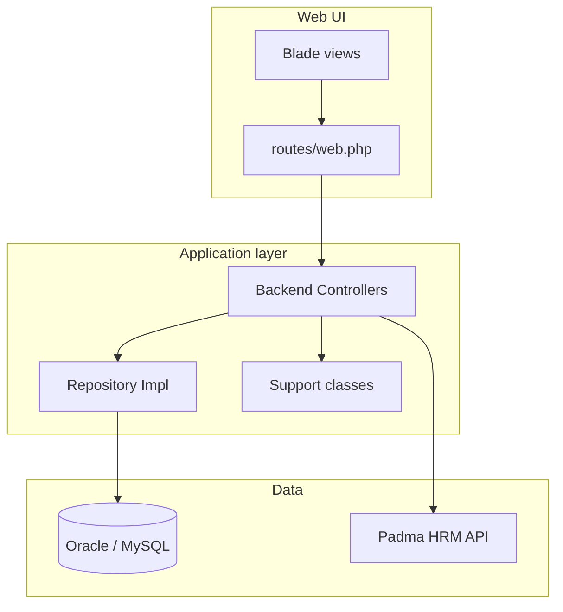
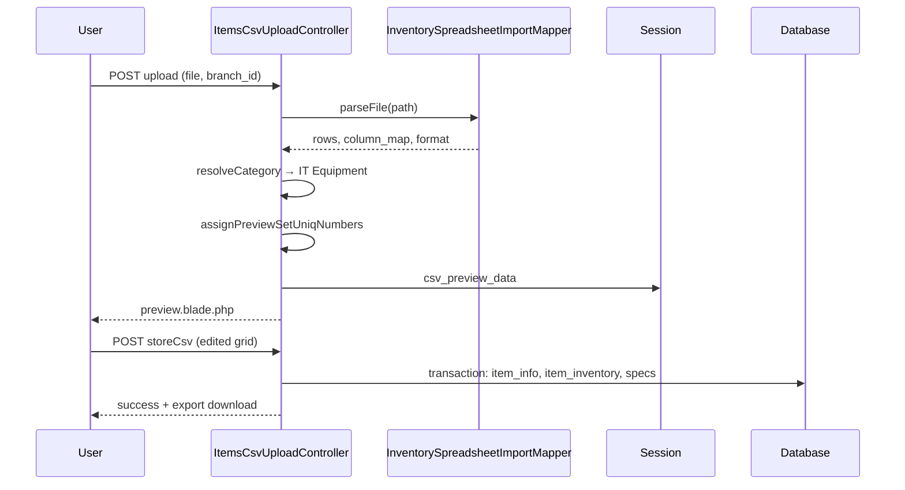

# Padma Inventory — Technical System Documentation

**Project:** `padma_inventory`  
**Purpose:** Padma Bank Limited IT asset / inventory management (stock in, stock out, branch inventory, employee assignment, reporting, procurement support).  
**Stack:** Laravel 12, PHP 8.2+, Blade, jQuery/Bootstrap (backend UI), Oracle (production via `yajra/laravel-oci8`) or MySQL (local/XAMPP).

> **Module-wise docs & structure:** see [docs/README.md](./README.md), [STRUCTURE.md](./STRUCTURE.md), and [docs/modules/](./modules/).  
> **Word file:** [docs/word/Padma_Inventory_Module_Documentation.doc](./word/Padma_Inventory_Module_Documentation.doc) (regenerate: `php docs/build_word_doc.php`).

---

## 1. System overview

The application is a monolithic Laravel web app. Business logic lives in **Controllers**, data access in **Repository implementations** bound to **Interfaces** in `RepositoryServiceProvider`. Most inventory state is stored in a central **`item_inventory`** table (and related master tables), differentiated by **`store_type`** and reference numbers (`set_uniq_no`, `stock_in_no`, `stock_out_no`).



---

## 2. Technology stack

| Layer | Technology |
|--------|------------|
| Framework | Laravel 12 |
| Language | PHP 8.2+ |
| Auth | Laravel UI (`Auth::routes`), session-based login |
| DB drivers | MySQL (dev), Oracle OCI8 (typical production schema `PAD_INVENTORY`) |
| Excel/CSV | `maatwebsite/excel`, `PhpOffice/PhpSpreadsheet` (branch upload mapper) |
| PDF | `barryvdh/laravel-dompdf` |
| Barcode | `milon/barcode`, `picqer/php-barcode-generator` |
| API auth (optional) | JWT (`tymon/jwt-auth`), Sanctum |
| Social login | Laravel Socialite (Google/Facebook controllers present) |

**Key Composer packages:** see `composer.json`.

---

## 3. Project structure

```
padma_inventory/
├── app/
│   ├── Http/Controllers/Backend/   # Feature controllers
│   ├── Http/Controllers/Auth/      # Login, password reset
│   ├── Interfaces/Repo/Backend/    # Repository contracts
│   ├── Repository/Backend/         # Repository implementations
│   ├── Models/                     # Eloquent models (subset of tables)
│   ├── Support/                    # Cross-cutting helpers (SET_UNIQ_NO, CSV mapper, stock refs)
│   ├── Traits/                     # UserAccessTraits, CommonTraits (HRM API)
│   └── Providers/RepositoryServiceProvider.php
├── routes/web.php                  # All primary HTTP routes
├── resources/views/backend/        # Admin/inventory UI
├── database/migrations/            # Laravel migrations + some .sql scripts
└── docs/                           # This document and related guides
```

---

## 4. Architecture patterns

### 4.1 Repository pattern

- **Interface:** `app/Interfaces/Repo/Backend/{Feature}Repo.php`
- **Implementation:** `app/Repository/Backend/{Feature}RepoImpl.php`
- **Registration:** `app/Providers/RepositoryServiceProvider.php`

Controllers depend on interfaces; implementations extend `EloquentBaseRepository` where applicable.

### 4.2 Access control

- **`UserAccessTraits::userAccessFunction()`** resolves menu slug from URL and loads **`access_menu`** row for the user’s **`user_types`** (view/add/edit/delete flags).
- Controllers call `$this->userAccessFunction()` and pass `$userAccessData` to views.
- Many backend controllers use `$this->middleware('auth')`.

### 4.3 Multi-tenancy scope

Most queries filter by **`org_id`** from `auth()->user()->org_id` and often **`branch_id`** / **`hr_branch_id`** on the `branch` table.

---

## 5. Core data model

### 5.1 Master data

| Table / area | Purpose |
|--------------|---------|
| `organization` | Organization master |
| `branch` | Branches; links to HR via `hr_branch_id` |
| `division`, `department` | Org structure |
| `category` / `categories` | Item categories (`category_title`, `category`) |
| `brand` / `brands` | Brands |
| `supplier` / `suppliers` | Suppliers |
| `item_info` | Item master (title, category, brand, image, etc.) |
| `unit` | Unit/size master |
| `users`, `user_types` | Application users |
| `backend_menu`, `access_menu` | Menu and RBAC |

> Note: Legacy naming mixes singular table names in queries (`item_info`, `category`) with migration names (`items`, `categories`). Code predominantly uses **`item_info`** and **`item_inventory`**.

### 5.2 Inventory fact table: `item_inventory`

Single table holds stock positions and movement-related rows. Important columns (conceptual):

| Field | Role |
|--------|------|
| `org_id`, `branch_id` | Scope |
| `item_id`, `category_id`, `brand_id`, `supplier_id` | References |
| `store_type` | **`SP`** = stock position / package row (inventory entry), **`SI`** = stock in transaction, **`SO`** = stock out transaction |
| `set_uniq_no` | Device/set identifier (e.g. `PBL-DK-5007`) |
| `stock_in_no`, `stock_out_no` | Document references |
| `uniq_serial_no` | Hardware serial |
| `quantity`, `price`, `condition`, specs (`ram`, `storage`, `processor`, …) |
| `from_employee_id`, `to_employee_id`, branch/division from/to | Assignment & movement |
| `warehouse`, `remarks`, `status` | `status <> 9` typically means active |

**Design rationale:** Stock in and stock out share one table; reports filter on `store_type` and reference numbers. See `STOCK_IN_OUT_IMPLEMENTATION.md` and `SCHEMA_RECOMMENDATIONS.md`.

### 5.3 Audit / movement logs

| Table | Purpose |
|--------|---------|
| `item_transfer_logs` | Employee-to-employee transfer within branch (from `/transfer-items`) |
| `item_swap_logs` | Pending swap between employees; receiver confirms on `/receive-swap-items` |
| `stock_out_gate_pass_logs` | Gate pass print audit |

---

## 6. Identifiers and codes

### 6.1 `SET_UNIQ_NO` — `App\Support\SetUniqNoFormatter`

- Format: **`PBL-{abbrev}-{sequence}`** (e.g. `PBL-DK-5007`).
- Abbreviation derived from item title (desktop → `DK`, laptop → `LP`, etc.).
- Sequence scoped per org/branch; considers existing `item_inventory` rows with `status <> 9`.

Used by: manual inventory entry, CSV import preview/import, spec component rows sharing one set code.

### 6.2 Stock reference numbers — `App\Support\StockReferencePrefixBuilder`

Builds **`stock_in_no`** / related prefixed strings from branch/division tags + `set_uniq_no`.

### 6.3 Item codes

`UserAccessTraits::generateRandomItemCode()` and item save logic in `ItemController` generate org-specific item codes from branch/category context.

---

## 7. Functional modules

### 7.1 Dashboard

| Route | Controller | Description |
|--------|------------|-------------|
| `/dashboard` | `HomeController` | Main dashboard |
| `/dashboard-total-count-log` | `DashboardLogController` | Aggregate counts |
| `/dashboard-*-details` | `DashboardLogController` | Category/item/supplier drill-down |

### 7.2 Administration

| Module | Routes (prefix) | Controller |
|--------|-----------------|------------|
| Users | `/users`, `/user-*` | `UsersController` |
| User types | `/user-type` | `UsersTypeController` |
| Permissions | `/permission`, `/give-permission` | `UserPermissionController` |
| Backend menu | `/backend-menu` | `MenuController` |
| Organization | `/organization` | `OrganizationController` |
| Branch | `/branch` | `BranchController` |
| Category | `/category` | `CategoryController` |
| Brand | `/brand` | `BrandController` |
| Supplier | `/supplier` | `SupplierController` |
| Unit | `/size-unit` | `UnitController` |
| Division / Department | `/division`, `/department` | `DivisionController`, `DepartmentController` |
| Warehouse | `/add-warehouse` | `WarehouseController` |

### 7.3 Item master

| Route | Controller | Description |
|--------|------------|-------------|
| `/items` | `ItemController` | CRUD item master (`item_info`) |
| `/items-by-category/{id}` | `ItemController` | AJAX items by category |

### 7.4 Item inventory (manual entry)

| Route | Controller | Description |
|--------|------------|-------------|
| `/items-inventory` | `ItemsInventoryController` | Create inventory (packages: main + RAM/storage/processor rows) |
| `/items-inventory-list` | `ItemsInventoryController` | List |
| `/items-inventory-edit/{id}` | `ItemsInventoryController` | Edit; loads specs by `set_uniq_no` |
| POST update/delete/active | `ItemsInventoryController` | CRUD |

**Behaviour highlights:**

- Item select can auto-fill **category** (`data-category-id`) and default **condition** to `good`.
- Specifications stored as separate `item_inventory` rows with same `set_uniq_no`, `store_type = SP`.

### 7.5 Branch Excel/CSV bulk upload

| Route | Name | Step |
|--------|------|------|
| `GET /items-inventory-csv-upload` | `items-inventory-csv-upload` | Select **branch**, upload file |
| `POST /items-inventory-csv-upload-process` | `items-inventory-csv-upload-process` | Parse → session preview |
| Preview view | — | Edit grid, confirm |
| `POST /items-inventory-csv-store` | `items-inventory-csv-store` | DB import + export session |
| `GET /items-inventory-csv-export-result` | `items-inventory-csv-export-result` | Download result Excel |
| `GET /items-inventory-csv-cancel` | `items-inventory-csv-cancel` | Clear session |

**Parser:** `App\Support\InventorySpreadsheetImportMapper`

- Detects header row and column aliases (Product Name, Serial No, Employee ID, wide matrix layouts).
- Formats: **`branch_inventory`**, **`wide_asset_matrix`** (Uttara-style laptop/monitor columns).
- **Category rule (branch import):** default category label **`IT Equipment`** for all preview/import rows (matched to `category` master when exists).
- **`SET_UNIQ_NO`:** auto-generated in preview; conflict checks on import.
- **Controller:** `ItemsCsvUploadController` — session keys: `csv_preview_data`, `csv_upload_branch_id`, `csv_import_meta`, `csv_upload_export_rows`.

See also: `CSV_UPLOAD_IMPLEMENTATION.md`, `CSV_UPLOAD_GUIDE.md`.

### 7.6 CSV receive (legacy/alternate)

| Route | Controller |
|--------|------------|
| `/items-inventory-csv-receive` | `ItemsCsvReceiveController` |

### 7.7 Stock out

| Route | Description |
|--------|-------------|
| `/stock-out`, `/stock-out-save-update` | Issue items (`store_type = SO`) |
| `/stock-out-list`, `/stock-out-invoice/{no}` | Listing & invoice |
| `/receive-stock` | Receive returned stock |
| `/transfer-items` | Transfer between employees (writes `item_transfer_logs`, remark on inventory) |
| `/return-to-division` | Return flow to division |

**Repository:** `StockOutRepo` / `StockOutRepoImpl`  
**Controller:** `StockOutController`  
**HRM:** Employee lookup via `CommonTraits::employeeInfo()` → `PADMA_HRM_API_URL`.

### 7.8 Item swap (same branch / division)

| Route | Description |
|--------|-------------|
| `GET /swap-items` | Initiate swap (from employee → to employee) |
| `POST /swap-items-save` | Creates `item_swap_logs`, marks inventory pending |
| `GET /receive-swap-items` | Receiver confirms |
| `POST /receive-swap-items-save` | Completes swap; `receive_remarks` |

**Repository:** `ItemSwapRepo` / `ItemSwapRepoImpl`  
**Model/table:** `item_swap_logs` (status: 1 pending, 2 received, 3 cancelled)

### 7.9 Stock in

| Route | Description |
|--------|-------------|
| `/stock-in`, `/stock-in-save-update` | Stock in (`store_type = SI`) |
| `/stock-in-list`, `/stock-in-invoice/{no}` | List & invoice |

**Repository:** `StockInRepo` / `StockInRepoImpl` (binding may need verification in `RepositoryServiceProvider` if DI fails in some environments).

### 7.10 Inventory reporting

| Route | Report |
|--------|--------|
| `/inventory-report` | Stock in/out summary |
| `/inventory-detail-report` | Detail grid |
| `/inventory-summary` | Division/branch summary |
| `/inventory-employee-report` | By employee |
| `*-export-excel`, `*-export-pdf` | Exports via Maatwebsite Excel / DomPDF |

**Repository:** `InventoryReportRepoImpl`

### 7.11 Procurement-related

| Module | Routes | Controller |
|--------|--------|------------|
| Requisition | `/create-requisition`, `/requisition-list` | `RequisitionController` |
| Quotation | `/create-quotation`, `/quotation-approve` | `QuotationController` |
| Delivery challan | `/delivery-challan` | `DeliveryChallanController` |
| Product repair | `/product-repair` | `ProductReturnController` |

Tables: `requisitions`, `requisition_items`, `quotations`, `quotation_items`, `quotation_approvals`, `delivery_challans`, `delivery_challan_items`, `product_returns`, etc. (see `database/migrations/`).

### 7.12 Inventory barcode (SET_UNIQ_NO labels)

| Route | Controller | Description |
|--------|------------|-------------|
| `GET /barcode-generate`, `/inventory-barcode` | `InventoryBarcodeController@index` | Filter form (division/branch, item, QTY, page layout) |
| `POST /inventory-barcode-generate` | `InventoryBarcodeController@generate` | Build CODE128 labels; preview on same page |
| — | Print button (JS) | Thermal-style **one label per page**, vertical preview |

**Repository:** `InventoryBarcodeRepo` / `InventoryBarcodeRepoImpl`  
**Support:** `BarcodeLabelSizeCatalog` (Word/Avery-style mm sizes)  
**Views:** `resources/views/backend/item/inventory_barcode/`  
**Oracle note:** non-empty `SET_UNIQ_NO` via `LENGTH(TRIM(...)) > 0`.

Module detail: [docs/modules/15-inventory-barcode.md](./modules/15-inventory-barcode.md).

---

## 8. Database scripts (A to Z)

| Script | Use |
|--------|-----|
| [docs/sql/PAD_INVENTORY_A_TO_Z_ORACLE.sql](./sql/PAD_INVENTORY_A_TO_Z_ORACLE.sql) | Oracle schema reference |
| [docs/sql/PAD_INVENTORY_A_TO_Z_MYSQL.sql](./sql/PAD_INVENTORY_A_TO_Z_MYSQL.sql) | MySQL local bootstrap |
| [docs/sql/PAD_INVENTORY_QUERIES_A_TO_Z.sql](./sql/PAD_INVENTORY_QUERIES_A_TO_Z.sql) | Inventory, barcode, stock queries |
| [docs/sql/README.md](./sql/README.md) | Execution notes |

Legacy SQL also under `database/*.sql` and Laravel `database/migrations/`.

---

## 9. External integration: Padma HRM API

**Trait:** `App\Traits\CommonTraits`

- **Env:** `PADMA_HRM_API_URL`
- **Flow:** Service login → bearer token → GET endpoints such as `/api/v3/user-info-padmaportal?emp_id=...`
- **Used by:** Stock out, transfer, swap, receive flows for employee name, branch, division validation.

Credentials for the API login are configured in code/env; production should use **environment secrets**, not hardcoded values in the repository.

---

## 10. Request lifecycle (example: CSV import)



---

## 11. Configuration and deployment

### 10.1 Environment (`.env`)

| Variable | Purpose |
|----------|---------|
| `APP_URL`, `APP_ENV`, `APP_DEBUG` | App base |
| `DB_CONNECTION`, `DB_*` | MySQL local or `oracle` connection |
| `PADMA_HRM_API_URL` | Employee API base URL |

Oracle-specific: `config/oracle.php`, package `yajra/laravel-oci8`.

### 10.2 Local development (XAMPP)

1. PHP 8.2+, Composer install  
2. `cp .env.example .env`, configure DB  
3. `php artisan key:generate`  
4. `php artisan serve` → `http://127.0.0.1:8000`  
5. Run migrations / legacy SQL scripts as required for your DB (`add_stock_in_no_to_item_inventory.sql`, swap/transfer migrations).

### 10.3 Web server

Point document root to `public/`. Ensure `storage/` and `bootstrap/cache/` are writable.

---

## 12. Security notes

- CSRF on POST forms (`VerifyCsrfToken`).
- Session authentication for backend routes using `auth` middleware.
- Menu-level permissions via `access_menu`; not all routes may enforce granular checks—review per module for hardening.
- File upload: CSV/XLSX size and extension validation in `ItemsCsvUploadController`.
- HRM API credentials must be rotated and stored in env/secrets manager.

---

## 13. Related documentation in repo

| File | Topic |
|------|--------|
| `STOCK_IN_OUT_IMPLEMENTATION.md` | Stock in/out on `item_inventory` |
| `SCHEMA_RECOMMENDATIONS.md` | Table usage patterns |
| `CSV_UPLOAD_IMPLEMENTATION.md` | CSV feature (partially superseded by branch Excel mapper) |
| `CSV_UPLOAD_GUIDE.md` | User-facing upload guide |
| `IMPLEMENTATION_SUMMARY.md` | Historical implementation notes |

---

## 14. Key classes quick reference

| Class | Responsibility |
|--------|----------------|
| `ItemsInventoryController` | Manual inventory CRUD, specs, edit modal |
| `ItemsCsvUploadController` | Branch spreadsheet upload, preview, import |
| `InventorySpreadsheetImportMapper` | Header detection, row mapping, IT Equipment default |
| `SetUniqNoFormatter` | PBL-style set codes |
| `StockReferencePrefixBuilder` | Stock in/out number prefixes |
| `StockOutController` / `StockOutRepoImpl` | Stock out, transfer, return |
| `ItemSwapController` / `ItemSwapRepoImpl` | Swap initiate/receive |
| `StockInController` / `StockInRepoImpl` | Stock in |
| `InventoryReportController` | Reports & exports |
| `InventoryBarcodeController` / `InventoryBarcodeRepoImpl` | Branch/division barcode labels |
| `BarcodeLabelSizeCatalog` | Label sheet dimensions for print CSS |

---

## 15. Document maintenance

- **Version:** 1.1 (March 2026 — barcode module + A–Z SQL)  
- **Update when:** New routes/modules added, `store_type` semantics change, CSV category rules change, or Oracle schema migrations applied.

For module-specific deep dives, extend this file or add `docs/modules/{module}.md`.
